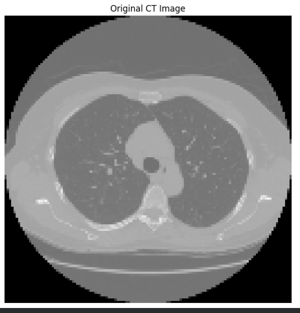
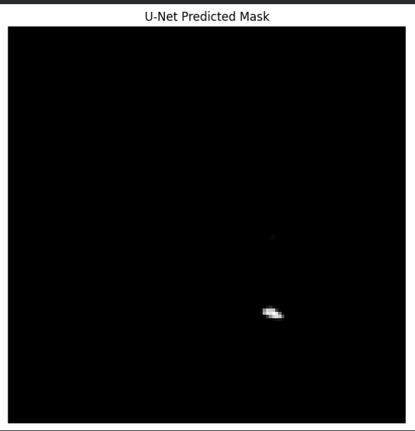
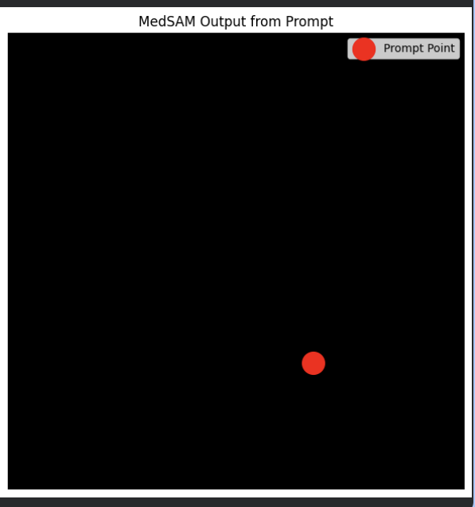

# Medical Image Segmentation Using U-Net and MedSAM
### Research Project

**📄 Published Research Paper:** [Read the Research Paper](https://www.taylorfrancis.com/chapters/edit/10.1201/9781042004607-49/benchmarking-medsam-cnn-net-organ-wise-medical-image-segmentation-girija-avula-venkata-naga-venu-nagaruru-rohankumar-reddy-sai-chakri)

## 📌 Overview
This project explores medical image segmentation using deep learning techniques. It combines **U-Net** for initial image segmentation with **MedSAM (Medical Segment Anything Model)** for prompt-based refinement of segmentation results on CT scan images.

## 🎯 Objectives
- Identify and segment regions of interest in medical CT images.
- Apply U-Net for initial segmentation.
- Explore MedSAM for prompt-based segmentation refinement.
- Visualize and compare segmentation outputs.

## ⚙️ Methodology
1. Preprocessed CT scan images for model input.
2. Applied U-Net to generate initial segmentation masks.
3. Used MedSAM for prompt-based segmentation refinement.
4. Visualized and compared the input images and segmentation results.

## 🛠️ Technologies Used
- **Language:** Python
- **Deep Learning:** PyTorch
- **Numerical Computing:** NumPy
- **Visualization:** Matplotlib
- **Segmentation Models:** U-Net and MedSAM

## 📊 Results

### Input Image


### U-Net Segmentation Output


### MedSAM Segmentation Output


## 🔍 Observations
The project demonstrates an approach to identifying regions of interest in CT images through deep learning-based segmentation. Combining U-Net with MedSAM enables exploration of initial segmentation and prompt-based refinement. The results also highlight opportunities to improve segmentation quality through further training and evaluation.

## ⚠️ Limitations
- Limited training data may affect generalization.
- Segmentation quality depends on preprocessing, model configuration, and prompt selection.
- Further quantitative evaluation and model tuning are required.

## 🚀 Future Improvements
- Train and evaluate using larger, more diverse datasets.
- Improve segmentation accuracy using appropriate evaluation metrics.
- Optimize inference performance.
- Explore deployment through a user-friendly application.

## 💻 How to Run

### 1. Clone the Repository
```bash
git clone YOUR_GITHUB_REPOSITORY_URL
cd YOUR_REPOSITORY_FOLDER
```

### 2. Install Dependencies
```bash
pip install -r requirements.txt
```

### 3. Run Inference
```bash
python inference.py
```

## ⚕️ Disclaimer
This project is intended for research and educational purposes only. Its outputs should not be used as a substitute for professional medical evaluation or clinical diagnosis.
